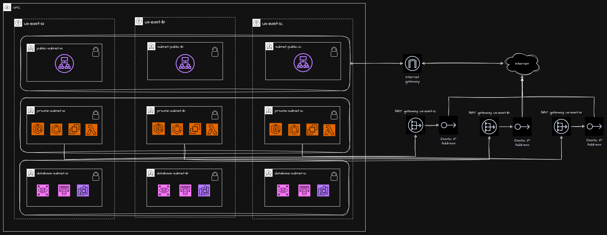
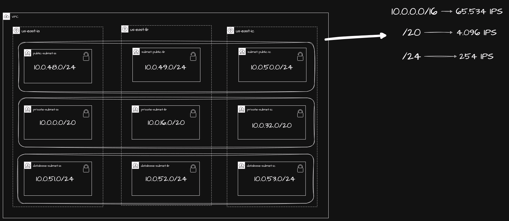

# infra-network

Infraestrutura Terraform responsável pela rede base na AWS. Provisiona uma
VPC de alta disponibilidade em três zonas, conectividade pública e privada e
publica no AWS Systems Manager Parameter Store os IDs consumidos por outros
produtos.

## Escopo

Este repositório cria:

- VPC `10.0.0.0/16` com DNS habilitado;
- três sub-redes públicas, três privadas e três de bancos de dados;
- Internet Gateway e rota pública;
- um NAT Gateway por zona e rotas de saída para as sub-redes privadas;
- parâmetros SSM com os IDs da VPC e de todas as sub-redes.

Fundação da conta, bucket de state, IAM e provedor OIDC pertencem ao
[`infra-bootstrap`](https://github.com/AloisioBarbosa/infra-bootstrap). Cluster
Kubernetes e workloads também estão fora deste escopo.

## Arquitetura





## Contrato SSM

O [`infra-cluster`](https://github.com/AloisioBarbosa/infra-cluster) consome os
parâmetros abaixo. O valor operacional de `project_name` deve permanecer
`infra-network` nos dois repositórios.

```text
/infra-network/vpc/vpc_id
/infra-network/vpc/subnet_private_1a
/infra-network/vpc/subnet_private_1b
/infra-network/vpc/subnet_private_1c
/infra-network/vpc/subnet_public_1a
/infra-network/vpc/subnet_public_1b
/infra-network/vpc/subnet_public_1c
/infra-network/vpc/subnet_databases_1a
/infra-network/vpc/subnet_databases_1b
/infra-network/vpc/subnet_databases_1c
```

Alterar esses nomes é uma mudança de contrato e exige coordenação com os
repositórios consumidores.

## Uso local

Pré-requisitos:

- Terraform 1.11 ou superior;
- credenciais AWS com acesso aos recursos de rede, aos parâmetros SSM e ao
  state no S3;
- acesso ao backend configurado em `backend.tf`.

```bash
cp terraform.tfvars.example terraform.tfvars
terraform init
terraform fmt -check -recursive
terraform validate
terraform plan
```

O arquivo `terraform.tfvars` é local e não deve ser commitado.

## CI/CD

O workflow `Terraform Pipeline` usa GitHub Actions e autenticação AWS via OIDC,
sem chaves AWS estáticas:

- `lint`: executa `terraform fmt`, `terraform validate` e TFLint;
- `trivy-scan`: gera o relatório SARIF sem bloquear o pipeline por achados;
- `plan`: executa em Pull Requests e manualmente no environment `plan`;
- `apply`: executa em pushes para `main` e manualmente no environment
  `production`;
- `destroy`: somente manual, também no environment `production`.

Variáveis usadas pelo workflow:

| Variável | Finalidade |
|---|---|
| `AWS_ROLE_ARN` | Role criada no `infra-bootstrap` e assumida via OIDC |
| `AWS_REGION` | Região AWS do backend e dos recursos |
| `TF_STATE_BUCKET` | Bucket S3 compartilhado para o state |
| `TF_STATE_KEY` | Chave do state deste produto |
| `TF_VAR_PROJECT_NAME` | Prefixo dos recursos e parâmetros SSM |
| `TF_VAR_REGION` | Região passada ao Terraform |
| `TF_VAR_ENVIRONMENT` | Ambiente usado em tags |

A trust policy da role deve autorizar os subjects OIDC dos environments
`plan` e `production`. A policy de permissões deve cobrir EC2, o prefixo SSM
`/infra-network/vpc/*`, `ssm:DescribeParameters` com `Resource = "*"` e os
objetos do state no S3. O lock usa `use_lockfile` no próprio S3; não há tabela
DynamoDB.

## Operação

- Não execute `plan` ou `apply` concorrentes sobre o mesmo state.
- Revise substituições e exclusões antes de aplicar um plano.
- Para rollback de código, reverta o commit e gere um novo plano.
- Não altere o state manualmente sem backup e plano de migração.
- Preserve o contrato SSM com os produtos consumidores.

## Licença

[MIT](LICENSE)
